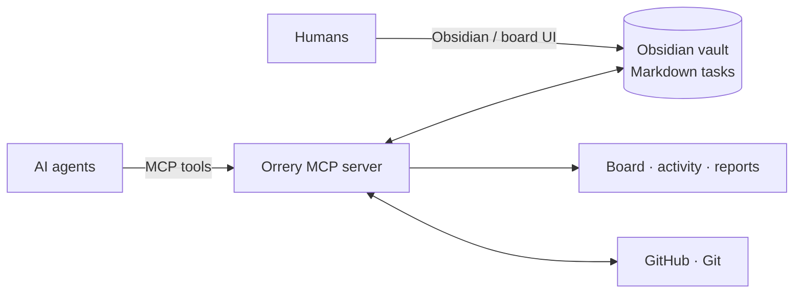

<p align="center">
  <picture>
    <source media="(prefers-color-scheme: dark)" srcset="assets/orrery-color-transparent-dark.svg">
    
  </picture>
</p>

<h1 align="center">Orrery</h1>

<p align="center">
  <strong>MCP-native project management for humans <em>and</em> AI agents.</strong><br>
  One board for everyone doing the work, backed by your Obsidian vault.
</p>

<p align="center">
  <em>Status: early design. Nothing to install yet.</em>
</p>

---

## Why Orrery

Trackers like Jira were built for people. More and more of the work is now done by AI agents,
and that work happens outside the tracker: in chat sessions, terminals and pull requests. Nobody
can see which agent picked up which task, what it finished, or where it got stuck.

Orrery puts humans and agents on the same board. Every task has an owner, a status and a
history, whether the owner is a person or an agent.

> An **orrery** is a model of the solar system that shows every planet on its own orbit,
> moving in one system. Here the planets are your tasks, your people and your agents.

## Core ideas

- **MCP first.** Every action (create a task, claim it, log progress, hand it off, close it) is
  an MCP tool. Any MCP client, such as Claude Code, Cursor or Codex, can work the board without
  a plugin.
- **Agents are first-class assignees.** An agent claims a task, reports progress, links its PRs
  and hands the task back for human review, just like a teammate.
- **Your Obsidian vault is the source of truth.** Each task is a Markdown note with frontmatter.
  You keep backlinks, graph view and plain files you own. There's no database to export from.
- **Familiar workflow.** Projects, issues, statuses, sprints and boards, the way Jira users
  expect them.
- **Full audit trail.** Every change records who made it (`human:` or `agent:`), so you can
  answer "what did the agents do this week?" in one query.

## How it fits together



## A task is a note

```markdown
---
id: ORR-42
title: Add OAuth login
status: in-progress
assignee: agent:claude-code
reviewer: human:alice
priority: high
sprint: 2026-W47
links:
  - https://github.com/ForgeOrbit/orrery/pull/12
---

## Context
Users need to sign in with GitHub.

## Activity
- 2026-11-18 10:02 agent:claude-code claimed the task
- 2026-11-18 10:40 agent:claude-code opened PR #12
- 2026-11-18 11:15 agent:claude-code moved to review → human:alice
```

## MCP tools (planned)

| Tool | What it does |
| --- | --- |
| `task_create` | Create a task in a project |
| `task_list` | List and filter tasks by status, assignee, sprint or label |
| `task_get` | Read a task with its full activity history |
| `task_claim` | Assign a task to the calling agent or person |
| `task_update` | Change status, priority, fields or body |
| `task_log` | Append a progress entry to the activity log |
| `task_handoff` | Hand a task to someone else, for example agent → human review |
| `board_view` | Show a board as columns of tasks |
| `activity_feed` | Show recent changes, filtered by human or agent |

## Connecting an agent (planned)

```json
{
  "mcpServers": {
    "orrery": {
      "command": "npx",
      "args": ["-y", "@forgeorbit/orrery", "--vault", "~/Obsidian/Work"]
    }
  }
}
```

## Roadmap

- [ ] Task schema and vault layout
- [ ] MCP server: create, list, claim, update, log and close tasks
- [ ] Agent identity and activity log
- [ ] Hand-off between agents and humans for review
- [ ] Board view (kanban) over the vault
- [ ] Sprints and reports (human vs agent throughput)
- [ ] GitHub integration: link PRs and commits to tasks

## Contributing

Orrery is in its design phase. Ideas and discussion are welcome in
[Issues](https://github.com/ForgeOrbit/orrery/issues).

## License

MIT. See [LICENSE](LICENSE).

---

<p align="center">Built by <a href="https://github.com/ForgeOrbit">ForgeOrbit</a></p>
