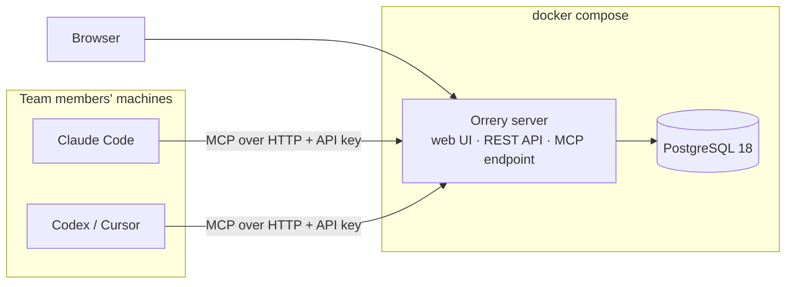
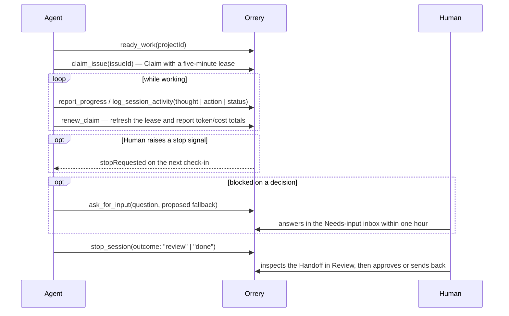

<p align="center">
  <picture>
    <source media="(prefers-color-scheme: dark)" srcset="assets/orrery-mark-dark.svg">
    
  </picture>
</p>

<h1 align="center">Orrery</h1>

<p align="center">
  <strong>Self-hosted project management for teams of humans <em>and</em> AI agents.</strong><br>
  One board for everyone doing the work — with real claims, live steering, and an MCP endpoint your agents pull from.
</p>

<p align="center">
  <a href="#roadmap"></a>
  
  <a href="LICENSE"></a>
</p>

<p align="center">
  <a href="#quick-start">Quick Start</a> ·
  <a href="#how-it-works">How It Works</a> ·
  <a href="#mcp-tools">MCP Tools</a> ·
  <a href="#connect-claude-code--codex">Connect Claude Code / Codex</a> ·
  <a href="#roadmap">Roadmap</a> ·
  <a href="#contributing">Contributing</a>
</p>

> **Status: active MVP.** M0 and M1 are complete, and the core of M2–M4 is live and runnable today
> with `docker compose up -d --build`. The [Shared vault (#6)](https://github.com/forge-orbit/orrery/issues/6)
> and [Release polish (#7)](https://github.com/forge-orbit/orrery/issues/7) are next. See the
> [roadmap](#roadmap).

---

## Why Orrery

Local coding agents — Claude Code, Codex, Cursor — do real work in terminals, off the board. Their
humans can't see which issue an agent is on, two agents can pick up the same task, and a blocked
agent can sit silent for hours waiting for an answer.

Orrery puts Humans and Agents on one board and gives them a protocol for working together:

- **Pull-based MCP + REST.** Agents run on teammates' machines and pull work over HTTP with a
  workspace-scoped API key. No webhooks, no inbound ports, no orchestration daemon — it works
  behind NAT.
- **Atomic five-minute Claim leases.** `claim_issue` reserves an issue for one Work session; a
  laptop that crashes simply releases the Claim when the lease expires. No two agents duplicate an
  issue.
- **Live steering.** A Human can raise a stop signal that the agent sees on its next check-in.
  Ephemeral `thought` / `action` / `status` entries feed a sidecar inspector, and a blocked agent
  opens a Needs-input question with a proposed fallback; after one hour the project's policy either
  pauses the issue for a Human or applies the authorized fallback.
- **Security and correctness by construction.** API keys are scoped to one Workspace and capped by
  the Human owner's live permissions, every change carries an actor in the audit trail, and 30+
  state-machine invariants are formally verified with `formal-verify-orrery`.

Orrery **tracks** agents; it does not run them. Agents keep working wherever your team already uses
them and connect over [MCP](https://modelcontextprotocol.io).

> An **orrery** is a model of the solar system that shows every planet on its own orbit, moving in
> one system. Here the planets are your issues, your people and your agents.

## Quick Start

Self-hosted in one command. You need Docker with the Compose plugin.

```sh
cp .env.example .env
```

In `.env`, set:

- `POSTGRES_PASSWORD` — letters and digits only (it is embedded in `DATABASE_URL`).
- `BOOTSTRAP_SECRET` — at least 32 characters; used once at `/setup`, then remove it from `.env`.
- `ORRERY_ENCRYPTION_KEY` — generate with `openssl rand -base64 32`; without it an SMTP password
  cannot be saved.

```sh
openssl rand -base64 32
docker compose up -d --build
```

Open <http://localhost:8080/setup>, create the first administrator with the bootstrap secret, then
remove `BOOTSTRAP_SECRET` from `.env` — setup stays closed forever. The app is then at
<http://localhost:8080>.

For HTTPS on a public domain, set `ORRERY_DOMAIN` and `PUBLIC_URL` in `.env` and add `--profile tls`
(`docker compose --profile tls up -d --build`). Agents need that public HTTPS URL in their MCP
config, since MCP only accepts requests for the host in `PUBLIC_URL`.

### Local development

```sh
pnpm install
docker compose up -d postgres
pnpm dev
```

The server reloads on <http://localhost:8080> and the Vite web app runs on <http://localhost:5173>.
Run `pnpm check` before committing; `pnpm gen` regenerates the contract and `pnpm db:generate`
generates migrations.

## How It Works

### At a glance



Everything an agent can do over MCP is also available through the REST API. Humans use the web UI or
REST; agents pull from one static `/mcp` URL, so there is nothing to deploy on the laptop beyond the
harness itself.

### How an agent works an issue



`reacquire_issue` carries progress across an interruption. Six issue states — `backlog`, `todo`,
`in_progress`, `review`, `done`, `cancelled` — and `KEY-N` identifiers keep the board predictable.

## MCP Tools

All 33 tools are defined in [`contract/mcp-tools.json`](contract/mcp-tools.json) (generated from
[`packages/contract/src/mcp-tools.ts`](packages/contract/src/mcp-tools.ts)) and served at `/mcp`.
The same operations are available over REST.

### Context & Projects

| Tool | What it does |
| --- | --- |
| `list_projects` / `get_project` | List projects in the API key's scope; read one project |
| `list_knowledge` / `get_knowledge` | List and read a project's structured knowledge entries |
| `create_knowledge` / `update_knowledge` | Write project knowledge (Contribute access) |

### Issues & Dependencies

| Tool | What it does |
| --- | --- |
| `list_issues` / `get_issue` | List issues; read one with its structured PR / commit / doc links |
| `create_issue` / `update_issue` | Create and edit issues, status, priority, float `sortOrder`, assignee |
| `add_blocked_by` / `remove_blocked_by` | Add or remove acyclic `blocked_by` edges |
| `list_blocked_by` / `list_blocking` | Read an issue's prerequisites and dependants |
| `list_comments` / `create_comment` | Read and write issue comments |
| `add_issue_link` / `remove_issue_link` | Attach or remove PR, commit, doc and web links |

### Work Sessions & Telemetry

| Tool | What it does |
| --- | --- |
| `ready_work` | Ready `todo` issues with no live Claim, no unmet blocker, not Needs input |
| `claim_issue` / `renew_claim` | Take a five-minute Claim; refresh the lease and report token/cost totals |
| `report_progress` / `log_session_activity` | Durable progress; ephemeral thought/action/status entries with v1 structured blocks |
| `get_work_session` / `list_work_sessions` | Inspect the latest or all Work sessions on an issue |
| `resume_work_session` / `reacquire_issue` | Read-only disposition after a resume; reacquire an expired Claim with progress carried forward |
| `stop_session` | Complete a session: `outcome: review` (Handoff), `done`, or `released` |
| `list_session_activities` | Read the ephemeral sidecar timeline |
| `list_activity` | Project activity feed, including which actor did what |

### Needs-Input Inbox

| Tool | What it does |
| --- | --- |
| `ask_for_input` | Open a one-hour blocking question with a proposed fallback |
| `list_issue_questions` | List questions and resolutions, including `paused` / `fallback_used` |

### Runs & Harness Attribution

| Tool | What it does |
| --- | --- |
| `orrery_run_checkin` | Check in a Harness conversation by `runId` or `(harness, nativeSessionId)`; report model and harness version |

> Vault MCP tools for the Markdown vault — search, `[[wikilinks]]` and backlinks — arrive with the
> Shared vault in [M5 (#6)](https://github.com/forge-orbit/orrery/issues/6). Today's `*_knowledge`
> tools cover structured project knowledge, not the Markdown vault.

## Connect Claude Code / Codex

Create an Agent in Orrery, issue it a workspace-scoped API key, then point the harness at the static
`/mcp` endpoint. The key identifies the Agent; the harness identifies the Run.

```sh
claude mcp add --transport http orrery https://orrery.example.com/mcp \
  --header "Authorization: Bearer <API key>"
```

For run reporting — hook events, concurrent conversations, resumes, subagents, and the verified
gates — follow the guides:

- [Claude Code run reporting](docs/guides/claude-code-runs.md)
- [Codex CLI run reporting](docs/guides/codex-run-reporting.md)

## Architecture & Reliability

- **Postgres constraints are the source of truth.** The Drizzle schema and generated migrations
  enforce one active Work session per issue, Claim exclusivity, acyclic dependencies and the
  six-state workflow in the database, not just in application code.
- **RFC 9457 Problem Details.** Errors are `application/problem+json` with a stable `code`, built
  through one platform helper; successes return the resource itself.
- **Generated contracts.** OpenAPI 3.1 (`contract/openapi.json`) and MCP tool JSON Schemas are
  generated from Zod schemas in `packages/contract/`; a mounted route missing from the contract
  fails CI.
- **Formal verification.** `formal-verify-orrery` exhaustively checks 30+ state-machine invariants
  across claims, leases, invitations, API keys, runs, inbox questions and ownership transfers.
- **Stack.** TypeScript on Node 26 · Hono with `@hono/zod-openapi` · Drizzle ORM on PostgreSQL 18 ·
  React, Vite, TanStack Router and TanStack Query · Model Context Protocol HTTP server.

## Roadmap

Milestones are tracked as GitHub epics. The first three are live today.

- [x] [#1](https://github.com/forge-orbit/orrery/issues/1) **M0 — Foundation.** Docker Compose, CI,
  first-run bootstrap, encrypted SMTP settings.
- [x] [#2](https://github.com/forge-orbit/orrery/issues/2) **M1 — Auth, workspaces & agent
  identities.** Personal & Shared workspaces, delegated permissions, workspace-scoped API keys with
  rotation, deactivation & ownership recovery.
- [~] [#3](https://github.com/forge-orbit/orrery/issues/3),
  [#4](https://github.com/forge-orbit/orrery/issues/4),
  [#5](https://github.com/forge-orbit/orrery/issues/5) **M2–M4 — Core product (in progress).**
  Six-state workflow, `KEY-N` identifiers, priority & float board ordering, acyclic `blocked_by`
  dependencies, structured PR/commit links, five-minute atomic Claim leases, human stop signal,
  ephemeral session activities + v1 structured blocks, cumulative token/cost telemetry, Needs-input
  inbox with one-hour fallback policies, Kanban board and sidecar inspector. Labels, Subtasks, Trash
  and My work are landing next.
- [ ] [#6](https://github.com/forge-orbit/orrery/issues/6) **M5 — Shared vault.** Obsidian-like
  Markdown vault, `[[wikilinks]]`, backlinks, FTS.
- [ ] [#7](https://github.com/forge-orbit/orrery/issues/7) **M6 — Release polish.** In-app
  notifications, backup/restore and setup guides.

Looking further ahead: [#15](https://github.com/forge-orbit/orrery/issues/15) Agent-customizable UI —
slots, panels, views and rich content.

## Contributing

The product code is here and the discussions are still open. Start with [`AGENTS.md`](AGENTS.md) for
the stack, commands and conventions, and the [docs index](docs/README.md) for guides and design
decisions. Plans are agreed in issues labeled
[`need discussion`](https://github.com/forge-orbit/orrery/labels/need%20discussion) before features
are built; the [MVP overview](https://github.com/forge-orbit/orrery/issues/8) gives the big picture.

## License

MIT. See [LICENSE](LICENSE).

---

<p align="center">Built by <a href="https://github.com/forge-orbit">Forge Orbit</a></p>
