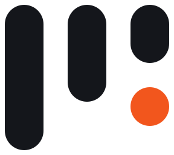
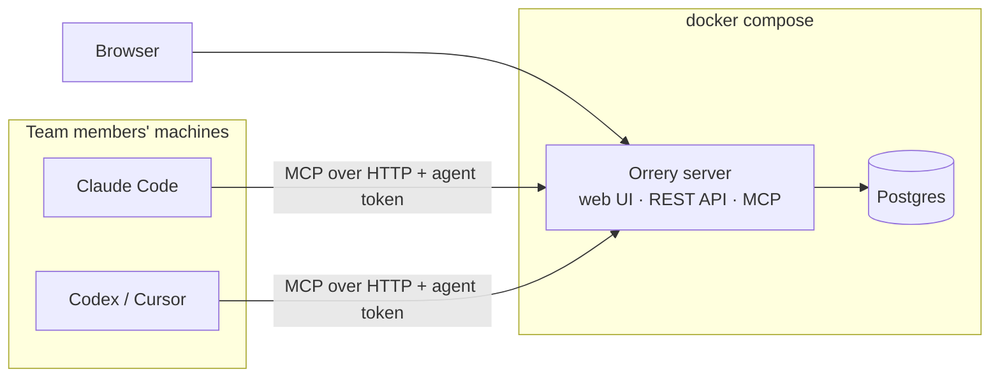
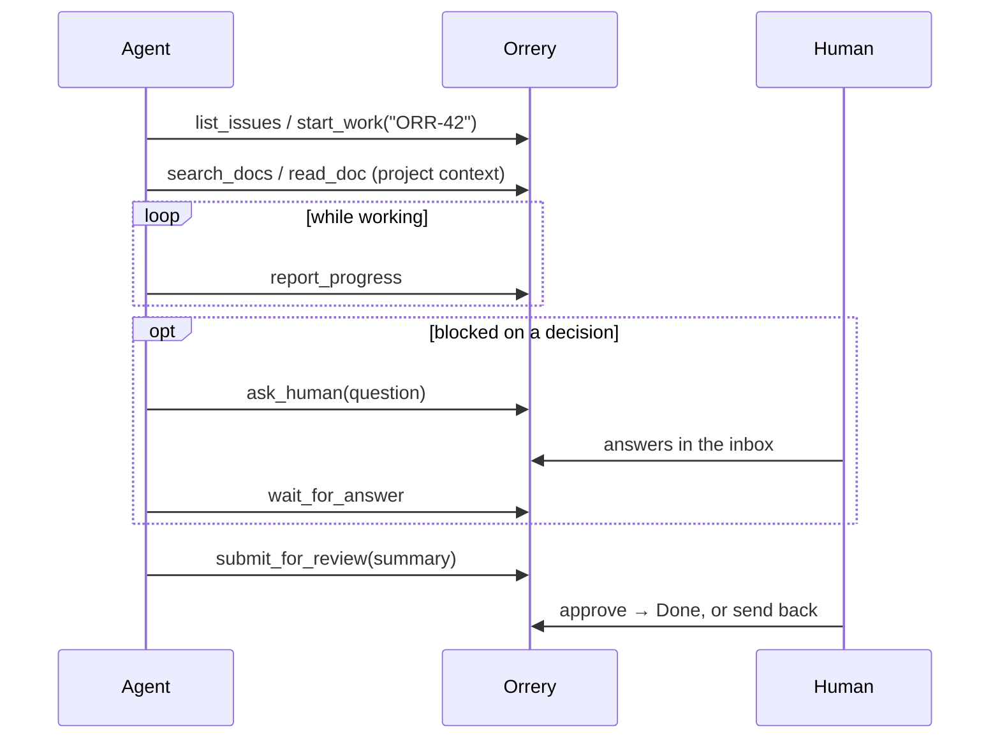

<p align="center">
  <picture>
    <source media="(prefers-color-scheme: dark)" srcset="assets/orrery-mark-dark.svg">
    
  </picture>
</p>

<h1 align="center">Orrery</h1>

<p align="center">
  <strong>Self-hosted project management for teams of humans <em>and</em> AI agents.</strong><br>
  One board for everyone doing the work, plus a shared knowledge base your agents can read and write.
</p>

<p align="center">
  <em>Status: design phase. Nothing to install yet. The MVP is being discussed in
  <a href="https://github.com/forge-orbit/orrery/issues/8">#8</a>.</em>
</p>

---

## Why Orrery

Trackers like Jira were built for people. More and more work is now done by AI agents, such as
Claude Code, Codex and Cursor, running on each team member's machine. That work happens outside
the tracker, so nobody can see which agent is working on what, which agent is stuck waiting for
an answer, or what the agents did this week.

Orrery puts humans and agents on the same board. An agent starts work on an issue, reports
progress, asks a human when it's blocked and submits its work for review, just like a teammate.

> An **orrery** is a model of the solar system that shows every planet on its own orbit,
> moving in one system. Here the planets are your issues, your people and your agents.

## What's planned for the MVP

- **Familiar project management.** Organizations, projects, issues, subtasks, labels, comments,
  and a board with Backlog → Todo → In progress → Review → Done.
- **Agents as workers.** Each team member registers their agents. An agent claims an issue
  through a *work session*, so two agents can never work the same issue at the same time, and
  an agent that crashes gives the issue back automatically.
- **Live agents panel.** See every running agent: which issue it's on, its latest progress and
  when it last checked in.
- **Needs-input inbox.** When an agent is blocked on a decision, it asks. Every open question
  from every agent lands in one inbox for humans to answer.
- **Human review.** Agents submit work for review; a person decides when it's done.
- **Shared vault.** An Obsidian-like Markdown knowledge base per organization and project, with
  `[[wikilinks]]` and backlinks. Agents search it for context before they start and write back
  what they learned.
- **Full audit trail.** Every change records who made it, a human or an agent.
- **Self-hosted.** One `docker compose up`: the Orrery server plus Postgres.

Orrery **tracks** agents; it does not run them. Agents run wherever your team already uses them
and connect to Orrery over [MCP](https://modelcontextprotocol.io).

## How it fits together



## How an agent works an issue



## MCP tools (planned)

| Group | Tools |
| --- | --- |
| Context | `whoami`, `list_projects` |
| Issues | `list_issues`, `get_issue`, `create_issue`, `update_issue`, `add_comment`, `add_link` |
| Work | `start_work`, `report_progress`, `ask_human`, `wait_for_answer`, `submit_for_review`, `stop_work` |
| Vault | `search_docs`, `list_docs`, `read_doc`, `write_doc` |

The full draft contracts are in [#4](https://github.com/forge-orbit/orrery/issues/4). Everything
an agent can do over MCP is also available through a REST API.

## Connecting an agent (planned)

Each agent gets its own token from your Orrery server. In Claude Code, for example:

```sh
claude mcp add --transport http orrery https://orrery.example.com/mcp \
  --header "Authorization: Bearer <agent token>"
```

## Tech direction (under discussion)

A Go server (REST + MCP) with a React web app embedded in a single binary, and Postgres for
storage. See [#1](https://github.com/forge-orbit/orrery/issues/1).

## Roadmap

The MVP is split into milestones. Each one is open for discussion before work starts.

- [ ] [#1](https://github.com/forge-orbit/orrery/issues/1) M0: Foundation (repo, Docker, CI, first-run setup)
- [ ] [#2](https://github.com/forge-orbit/orrery/issues/2) M1: Auth, organization and agent identities
- [ ] [#3](https://github.com/forge-orbit/orrery/issues/3) M2: Projects and issues
- [ ] [#4](https://github.com/forge-orbit/orrery/issues/4) M3: Agent API and work sessions
- [ ] [#5](https://github.com/forge-orbit/orrery/issues/5) M4: Board, agents panel and needs-input inbox
- [ ] [#6](https://github.com/forge-orbit/orrery/issues/6) M5: Shared vault
- [ ] [#7](https://github.com/forge-orbit/orrery/issues/7) M6: Release polish

Later: sprints, epics, custom workflows, a GitHub app, Obsidian git sync, and reports on human
vs. agent throughput.

## Contributing

Orrery is in its design phase. The best way to help right now is to join the discussion:
the [MVP overview](https://github.com/forge-orbit/orrery/issues/8), the
[product questions](https://github.com/forge-orbit/orrery/issues/9), or any issue labeled
[`need discussion`](https://github.com/forge-orbit/orrery/labels/need%20discussion).

## License

MIT. See [LICENSE](LICENSE).

---

<p align="center">Built by <a href="https://github.com/forge-orbit">ForgeOrbit</a></p>
